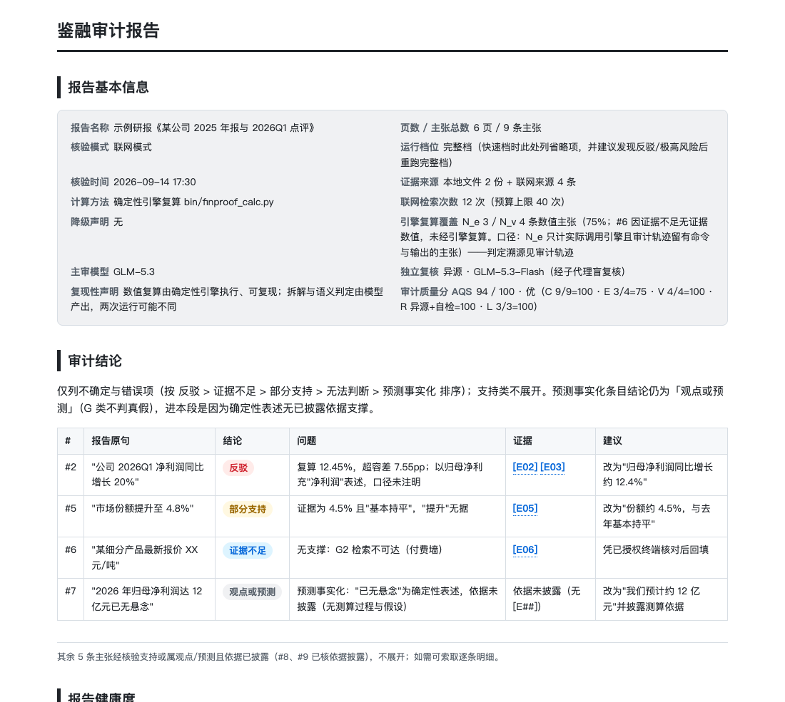
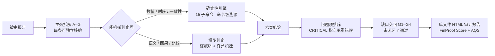

# 鉴融 · FinProof

**通用 AI 报告审计 agent：把 AI 写出来的报告拆成可核验主张，逐条复算、判定、溯源，给出可复算的双分。**

[](https://github.com/LZIFE/finproof/actions/workflows/ci.yml)
[](LICENSE)
[](CHANGELOG.md)

> **English** — Jianrong (FinProof) is an audit agent for AI-generated reports. It decomposes a report into checkable claims, recomputes every number with a deterministic engine at published tolerances (0.1% relative; 0.5pp for growth rates), checks citations — including a temporal-impossibility check that rejects a source by logic alone — and emits six-class verdicts with a per-claim evidence chain. The output is a single-file HTML audit report with a dual score (the report's evidence-chain quality alongside the audit process's own quality), and every number in it is recomputable. Benchmarks and all raw outputs live in [`evaluation/`](evaluation/README.md).

---

## 为什么需要它

AI 已经把写稿从几天压到几分钟，也批量生产了四类错误：**数字幻觉、口径混用（归母↔扣非、单季↔累计）、引用错配（页码 / 期间 / 来源）、编造引文**。这些错误读起来都很顺，肉眼极难发现，发布出去就是风险。

鉴融不做"再写一篇报告"。它做**发布前的审计层**：报告里每一个可核验的判断，要么被原始来源支撑，要么被明确指出问题，要么诚实地交回成待核项——三者必居其一，不允许含糊。



> 完整示例是单文件 HTML（无外部依赖，下载后浏览器打开）：[`audit_template_demo_76.html`](audit_template_demo_76.html)。

## 一次审计产出什么

不是一段"检查意见"，而是一份可交付、可复算的审计报告：

1. **报告基本信息** —— 核验模式（本地 / 联网）、运行档位、降级声明、引擎复算覆盖率 N_e/N_v、主审模型与独立复核方式；
2. **审计结论** —— 只列不确定与错误项，按 `反驳 > 证据不足 > 部分支持 > 无法判断 > 预测事实化` 排序，每条给出原文、结论、问题、证据编号与修改建议；
3. **报告健康度** —— N / N_d / N_c / N_v / N_e 口径与五维得分明细，每个维度都能手算复核；
4. **扣分清单** —— 每一分扣在哪条主张、哪条证据上，逐条可回溯；
5. **证据清单** —— 每条证据带可点击来源、链接复验状态与时间、定位（页码/段落）、**逐字摘录**；
6. **主张核验卡** —— 问题主张的完整判定过程：报告值 → 证据值 → 引擎复算 → 容差判断 → 结论；
7. **需用户自行核验清单** —— 按 `G1 源文件缺失 / G2 检索不可达 / G3 非公开数据 / G4 提取失败` 分类，标注"未闭环 ≠ 通过"；
8. **对抗性抽查与独立复核** —— 近容差、口径伪装、时序不可能、预测事实化逐项过一遍；问题项交异源模型盲复核（或至少机械自检：引擎重跑 + 摘录复读）。

## 审计流水线



## 核心能力

| 能力 | 实现 |
|---|---|
| **主张拆解** | 把报告拆成 A 原始数字 / B 计算型 / C 口径型 / D 业务事实 / E 因果型 / F 比较型 / G 预测，按类型分配核验策略 |
| **确定性引擎** | [`finproof_calc.py`](finproof-verifier/skills/finproof-verification/bin/finproof_calc.py)，纯标准库 `decimal`，**15 个子命令**（同比、累计转单季、毛利率、CAGR、EPS、ROE、资产负债率、总和一致性、时序检查…），54 项回归测试 |
| **判定纪律** | 八步判定链 → 六类结论（支持 / 反驳 / 部分支持 / 证据不足 / 观点或预测 / 无法判断），每条判定必须能指到证据与计算 |
| **容差纪律** | 数值相对 0.1%；增长率 0.5pp；披露舍入豁免最多 0.5%（唯一例外）——**该放过的精确放过，不"见差就报"** |
| **时序不可能** | 来源覆盖期间早于数据所属期间时，无需证据闭环、纯逻辑判 `IMPOSSIBLE`（E5 时序错配在十轮对照中全灭，v2.6.0 后成为唯一被完整检出的框架独占点） |
| **预测事实化** | G 类不判真假，但标注"依据已披露 / 未披露"；"已无悬念"这类确定性措辞列入问题项 |
| **双分体系** | FinProof Score 度量**被审报告**的证据链质量；AQS 度量**审计过程**本身，两分并列、互不替代 |
| **缺口诚实交回** | 查不到就说查不到，G1–G4 分类 + 按影响排序的自核清单 |
| **包自检** | [`check_package.py`](finproof-verifier/check_package.py) 43 项一致性检查（版本、档位行、算例自洽、引擎-文档同步、zip 新旧…） |

### 两个分数，各管各的

- **FinProof Score** = `0.25×可判定率 + 0.25×数字准确性 + 0.20×引用一致性 + 0.15×来源权威性 + 0.15×时间与口径一致性`，惩罚系数 2，公式、分子分母、扣分项全部公开。
- **AQS（Audit Quality Score）** = 主张覆盖 30% + 引擎复算率 25% + 证据可核性 20% + 复核完成度 15% + 链接复验率 10%，**只度量审计过程，不度量判定正确性**。

为什么需要 AQS：一份错误很多的报告，被审得越认真、抓得越准，FinProof Score 反而越低——用户容易误读成"审计没做好"。AQS 把"审计做得怎么样"单独拎出来，两分并列展示。

## 实测（诚实版）

六轮 18+2 次两臂对照、同一基座模型、唯一变量是"裸提示 vs 鉴融方法论"，全部原始输出在 [`evaluation/runs/`](evaluation/runs/)：

| 轮次 | 场景 | 裸提示基线 | 鉴融 | 判定 |
|---|---|---|---|---|
| 一 | 短报告 + 证据包（GLM-5.3 ×2） | 17/18 ×2 | 15/18 ×2 | 检出打平 |
| 二 | 短报告 + 证据包（Flash ×2） | 17/18 ×2 | 17/18 · 16/18 | 检出打平 |
| 三 | 长报告 51 主张（×1） | 21/24 | 22/24 | 检出打平 |
| 四 | 无证据包 + 联网（×2） | 17/18 ×2 | 17/18 · **18/18** | 打平；**时序不可能仅鉴融完整检出** |
| 五 | 近容差专项（×2） | 12/12，误伤 2–3 | 12/12，**误伤 0** | **容差纪律分离：12 vs 10** |
| 六 | 定性专项（×1） | 14/14 | 14/14 | 检出打平，产出层差异延续 |
| 外部 | Fin-Fact 真实主张 50 条 | 严格一致 92% | 78%（硬错误 1 vs 2） | 产出层差异 |

**结论（不粉饰）**：在证据齐全的报告上，"专门框架能查出通用 agent 查不出的错误"**不成立**。鉴融的真实增益在产出层——**该放过的精确放过**（近容差零误伤）、**纯逻辑检出点**（时序不可能）、**审计级产出**（逐主张编号 / 引擎命令级溯源 / CRITICAL 分级 / 诚实缺口）、**真实语料硬错误更少**。所以本项目不以"检出更多"为卖点，卖点是：*同样一句"帮我看看这份报告"，把自由文本意见变成可复算、可追溯、可入库、会排序的审计结论。*

完整过程、分歧与失败案例见 [`evaluation/测评报告.md`](evaluation/测评报告.md)、帕累托验证见 [`evaluation/帕累托验证.md`](evaluation/帕累托验证.md)。

## 快速开始

### 1. 跑确定性引擎（零依赖）

```bash
python3 finproof-verifier/skills/finproof-verification/bin/finproof_calc.py --help

python3 finproof-verifier/skills/finproof-verification/bin/finproof_calc.py \
  yoy --current 2.8 --previous 2.49
# {"yoy_pct": 12.449799196787149, "detail": "( 2.8 − 2.49 ) / 2.49 × 100 = 12.4498%"}
```

### 2. 自检

```bash
python3 -m pytest finproof-verifier/skills/finproof-verification/bin/test_finproof_calc.py -q   # 54 passed
python3 finproof-verifier/check_package.py                                                      # 43 项全绿
```

### 3. 作为 agent 技能使用

包结构：

```text
finproof-verifier/
├── agents/finproof-verifier.md            角色、流程与操守
├── skills/finproof-verification/
│   ├── SKILL.md                           完整档操作手册（自足）
│   ├── LITE.md                            快速档执行卡（短报告 / 低预算）
│   ├── references/                        16 份细则（评分规格、模板、复核协议…）
│   └── bin/finproof_calc.py               确定性引擎
└── .codebuddy-plugin/plugin.json          插件清单（版本 / 技能 / 提示词）
```

宿主支持 skills 目录时（Claude Code / CodeBuddy / WorkBuddy），把 `skills/finproof-verification/` 放入并声明即可；也可以整目录注册为专家包。然后一句话：

> 审计这份 AI 生成报告：每条结论都要给出可点开的来源链接与原文摘录，并说明报告分与审计分是怎么算出来的。

短报告可以用快速档（`LITE.md`），它会保留三项硬检查（数值复算、容差、引用三对齐），省略长报告才需要的分批审协议。

## 仓库结构

```text
finproof/
├── finproof-verifier/          ★ 产品本体：agent + 技能 + 引擎 + 包自检（v2.8.0）
├── evaluation/                 六轮两臂对照、评分密钥、原始输出、真实语料
├── audit_template_demo_76.html 审计报告完整示例（单文件 HTML）
├── backend/                    历史参考实现：FastAPI + SQLite 混合核验服务（984 tests）
├── frontend/                   Next.js 演示前端
├── docs/                       架构、产品方案、仓库地图
├── scripts/                    数据与评测脚本
└── .github/workflows/ci.yml    CI：引擎测试 + 包检查 + 后端容差对齐
```

> `backend/` 是把"主张拆解 → 检索 → 证据门控 → 确定性复算"做成服务的参考实现（历史阶段 43 条 claims 上 Accuracy 0.7442 / Macro-F1 0.7264），与 `finproof-verifier/` 的方法论同源；产品本体以技能包为准。

## 文档

| 文档 | 内容 |
|---|---|
| [`finproof-verifier/README.md`](finproof-verifier/README.md) | 产品手册：定位、用法、评分规格、完整变更记录 |
| [`docs/REPO_MAP.md`](docs/REPO_MAP.md) | 仓库地图（先读这个） |
| [`CHANGELOG.md`](CHANGELOG.md) | 版本摘要 |
| [`evaluation/README.md`](evaluation/README.md) | 测评资产索引与复现要点 |
| [`SKILL.md`](finproof-verifier/skills/finproof-verification/SKILL.md) | 完整方法论（跟随包分发，不依赖宿主人设） |
| [`scoring-spec.md`](finproof-verifier/skills/finproof-verification/references/scoring-spec.md) | 评分规格：公式、算例、边界 |
| [`docs/finproof_architecture.md`](docs/finproof_architecture.md) | 混合核验架构说明 |
| [`docs/final_submission_report.md`](docs/final_submission_report.md) | 参考实现的评测报告 |

## 边界（不做什么）

- **不判预测真假**：预测 / 主观判断标为观点，只核"依据是否披露"，不用真值去判；
- **不给投资建议**：不预测涨跌、不给买卖建议；
- **未闭环不等于通过**：查不到就是查不到，交回用户核；
- **AQS 不度量判定正确性**：它需要外部金标准，AQS 只保证过程完备与诚实；
- **分数不可跨报告比较**：分子分母随报告自身主张数变化；
- **审计分是专家自评**：有异源复核时如实标注，没有就写"未复核"，不伪造。

## License

[MIT](LICENSE) © 2026 FinProof / 鉴融