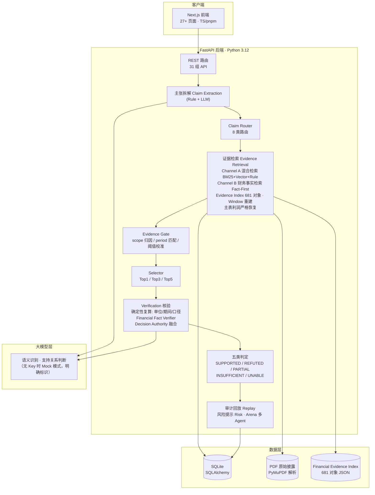
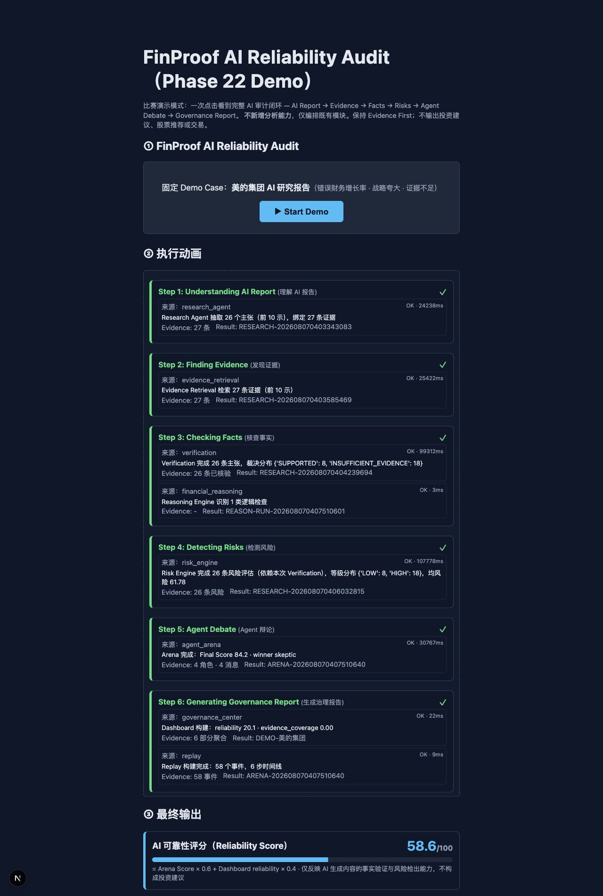
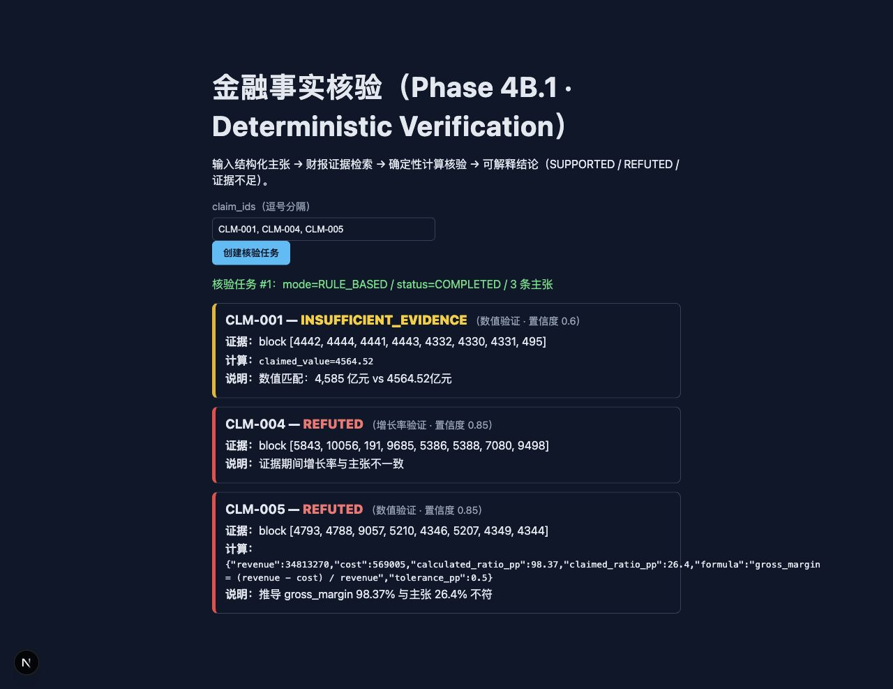
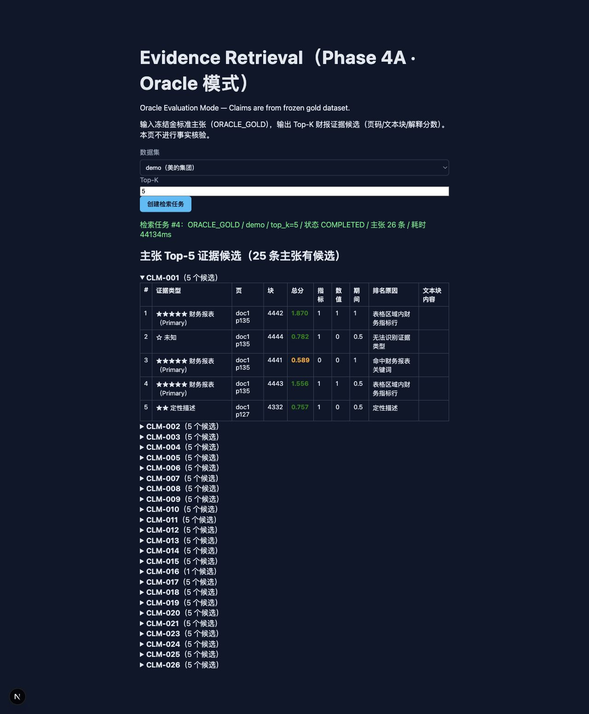
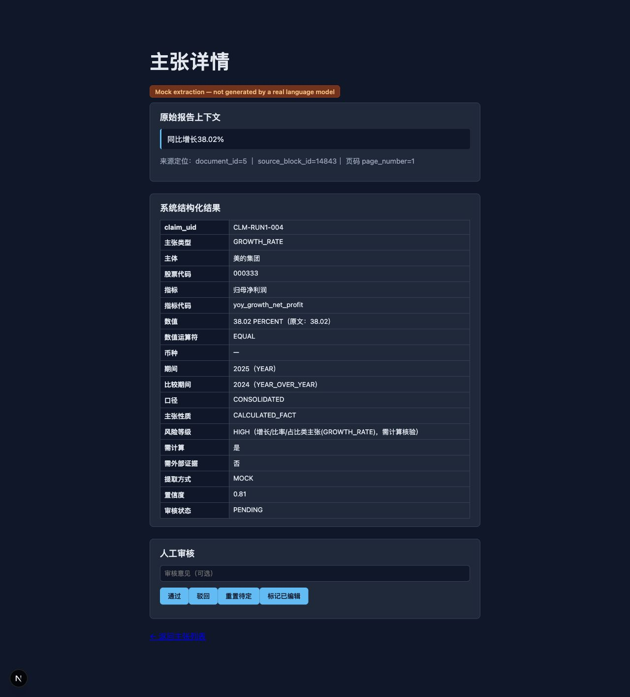
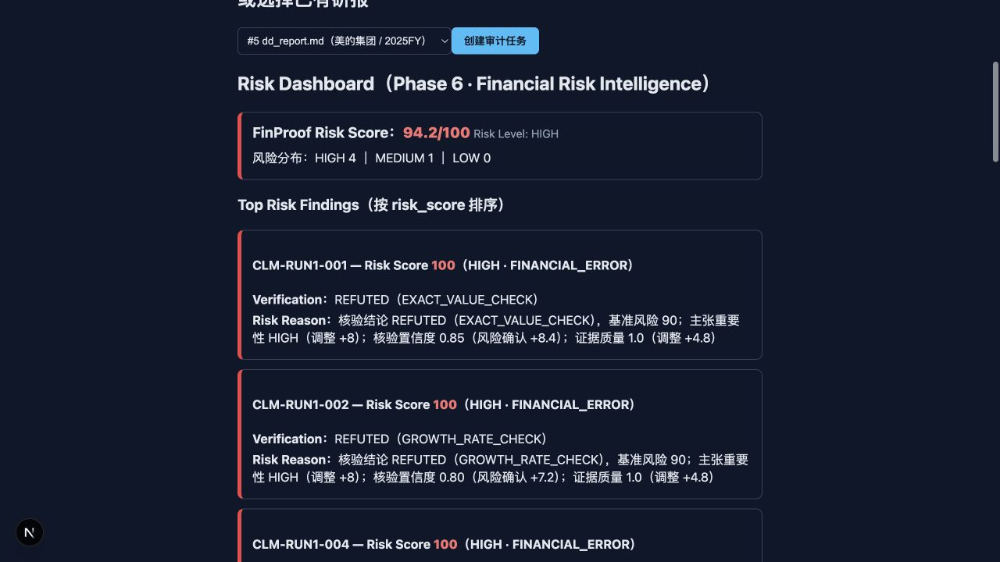
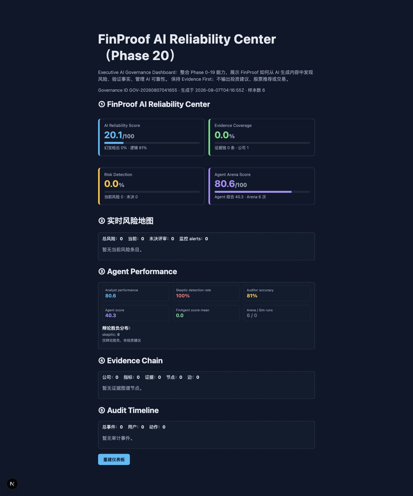

# FinProof 鉴融 — 金融研究报告事实核验与证据链智能体

> **让金融报告中的每一个数字，都能被重新计算；让每一个结论，都能找到原始证据。**

FinProof 是一个面向金融研究报告的 **事实核验与证据链 Agent**。它将研究报告拆解为可核验的金融主张（Claim），对照交易所原始披露文件（年度报告 / 季度报告 / 半年度报告 PDF）重新计算财务指标，输出 **支持 / 反驳 / 部分支持 / 证据不足 / 无法判断** 五类核验结果，并生成可追溯、可回放的审计报告。

> 完整产品方案见 [docs/finproof_product_spec.md](docs/finproof_product_spec.md)（25 章）。

---

## 📺 演示视频

> 演示视频链接（录屏，展示「上传研报 → 主张拆解 → 证据检索 → 事实核验 → 风险提示 → 审计回放」全流程）：

**▶️ [FinProof 产品演示视频](docs/demo/finproof-demo.mp4)**

> 4 分钟中文旁白与字幕演示，覆盖一键 Demo、证据检索、主张详情、事实核验、审计风险与可靠性仪表盘。

---

## 目录

- [🔍 产品定位](#-产品定位)
- [🏗️ 系统架构](#-系统架构)
- [⚙️ 核心模块](#-核心模块)
- [📊 性能数据](#-性能数据)
- [🚀 快速开始](#-快速开始)
- [🖥️ 演示流程](#-演示流程)
- [🧭 落地场景](#-落地场景)
- [🎯 目标客户](#-目标客户)
- [💰 商业模式](#-商业模式)
- [📚 文档索引](#-文档索引)
- [📁 目录结构](#-目录结构)

---

## 🔍 产品定位

金融投资研究中大量依赖研究报告中的数字（营收、净利润、现金流、增长率等）。这些数字一旦出现记忆偏差、口径混用（如把"归母净利润"当"净利润"）、对错期间（如把"单季"当"累计"）、或 simply 虚构，会直接误导投资决策。

FinProof 将"人肉翻报告核对"这一耗时、易错的工作，自动化交给一个 **可解释、可追溯的 Agent 智能体**：

1. **主张拆解**：从研报中抽取结构化金融主张（指标 / 数值 / 期间 / 口径 / 单位）。
2. **证据检索**：在原始披露 PDF 中混合检索（BM25 + 向量 + 规则 + 财务事实索引），召回证据块。
3. **事实核验**：确定性程序复算数字（单位换算、同比环比、累计转单季、口径归属），LLM 处理语义与支持关系判断。
4. **五类判定**：SUPPORTED / REFUTED / PARTIALLY_SUPPORTED / INSUFFICIENT_EVIDENCE / UNABLE_TO_DETERMINE。
5. **审计回放**：每一步的证据、计算、判定依据全部留痕，可逐层回放追溯。

**混合核验架构**：数字格式化、单位/币种、同比/环比、累计转单季、比率比较由**确定性程序**负责（可复现、无幻觉）；主张拆解、语义识别、证据支持关系、因果/预测检测由**大模型**负责；无 API Key 时走明确标识的 **Mock 模式**（输出带 "Mock" 标识，不伪装真实模型结果）。

---

## 🏗️ 系统架构

### 架构总览（Mermaid，GitHub/AtomGit 可直接渲染）



### 架构分层图（文本版）

```text
┌────────────────────────────────────────────────────────────────────────────┐
│                        FinProof 混合核验架构                                │
└────────────────────────────────────────────────────────────────────────────┘

┌──────────────┐   ┌──────────────┐   ┌──────────────┐   ┌──────────────┐
│  Next.js 前端 │──▶│  FastAPI API  │──▶│ SQLite (SQLA) │  │  PDF 解析     │
│  TS / pnpm    │   │  Python 3.12  │   │  + FinFact索引 │  │  PyMuPDF      │
└──────────────┘   └──────┬───────┘   └──────────────┘   └──────────────┘
                          │
              ┌───────────▼───────────┐
              │   Claim 主张拆解       │
              │   (Rule + LLM)        │
              └───────────┬───────────┘
                          │
              ┌───────────▼───────────┐
              │   Claim Router        │  8 类路由：STRUCTURED_NUMERIC /
              │   (8 routes)          │  PERIOD_COMPARISON / SCOPE_VALIDATION
              └───────────┬───────────┘  TABLE_METRIC / NARRATIVE_FACT / ...
                          │
              ┌───────────▼───────────┐
              │   Evidence 检索        │
              │  ┌─────────────────┐  │
              │  │ Channel A: 混合  │  │  BM25 + Vector + Rule
              │  │ Channel B: Fact  │  │  Financial Evidence Index (681 对象)
              │  └─────────────────┘  │  Fact-First 检索 + Evidence Window 重建
              └───────────┬───────────┘  + 严格主表利润证据恢复
                          │
              ┌───────────▼───────────┐
              │   Evidence Gate       │  scope 归因 / period 匹配 / 阈值校准
              │   Selector (Top1/3/5) │
              └───────────┬───────────┘
                          │
              ┌───────────▼───────────┐
              │   Verification 核验    │  ┌──────────────────────────┐
              │  ┌─────────────────┐  │  │ 确定性: 数字/单位/期间/口径 │
              │  │ Financial Fact  │  │  │ 财务事实比较器 (单位归一楼) │
              │  │ Verifier (LLM)  │  │  │ Decision Authority 融合    │
              │  └─────────────────┘  │  └──────────────────────────┘
              └───────────┬───────────┘
                          │
              ┌───────────▼───────────┐
              │  判定: SUPPORTED /     │
              │  REFUTED / PARTIAL /   │
              │  INSUFFICIENT / UNABLE │
              └───────────┬───────────┘
                          │
              ┌───────────▼───────────┐
              │  审计回放 / 风险提示    │  Audit Trail + Replay + Arena
              └───────────────────────┘      多 Agent 对抗 + 可靠性评估
```

**核心设计原则**：
- **可复现**：所有数值复算走确定性程序，同一输入同一输出。
- **可追溯**：从 Claim 到证据块到最终判定，全链路留痕。
- **可解释**：每个判定附证据文本、计算过程、scope/period 匹配依据。
- **安全加固**：输入校验、XSS/注入防护、投资建议禁用词（Prompt Injection 防护）。

---

## ⚙️ 核心模块

### 1. 主张拆解与路由（Claim Router）
- 将研报段落拆解为结构化金融主张：`metric / value / period / scope / unit / claim_type`。
- **8 类路由**：`STRUCTURED_NUMERIC`、`PERIOD_COMPARISON`、`SCOPE_VALIDATION`、`TABLE_METRIC`、`NARRATIVE_FACT`、`INSUFFICIENTLY_PARSED`、`FORECAST`。
- 代码：[backend/app/services/claim_router.py](backend/app/services/claim_router.py)

### 2. 证据检索（Evidence Retrieval）
- **双通道检索**：Channel A 混合检索（BM25 + 向量 + 规则）；Channel B 财务事实检索（company+metric+value+period 联合）。
- **Financial Evidence Index**：681 个证据对象，覆盖利润表 / 资产负债表 / 现金流量表 / 附注 / MD&A / 财务亮点，含四维置信度质量分。
- **Evidence Window 重建**：跨块组装 FinancialEvidenceObject，解决 PDF 表格切块导致的证据断裂。
- **严格主表利润证据恢复**（`financial_summary_evidence.py`）：对归母净利润 / 扣非归母净利润两类 intrinsic-scope 指标，按公司+期间+指标+值+单位换算+披露舍入严格重建主表行，排除扣非混淆。
- 代码：[backend/app/services/evidence_retrieval/](backend/app/services/evidence_retrieval/)

### 3. 证据门控与选择（Evidence Gate / Selector）
- **Gate**：scope/period/实体 匹配门控，`_effective_scope` 从 metric_code 推断 intrinsic scope（归母/扣非），避免验证前误拒正确证据。
- **Selector**：Top1 / Top3 / Top5 候选举证策略。
- 代码：[backend/app/services/evidence_gate.py](backend/app/services/evidence_gate.py)、[backend/app/services/evidence_selector.py](backend/app/services/evidence_selector.py)

### 4. 事实核验（Verification）
- **确定性复算**：数字格式化、单位/币种归一、同比/环比、累计转单季、比率与差异比较。
- **财务事实 Verifier**：metric 别名/家族归一 + 单位归一 + 容差 + metric strictness + period-aware 匹配。
- **Decision Authority 融合**：quality≥0.8 + 全字段匹配 → fact 优先；双路径（fact + block verification）70/30 权重融合。
- 代码：[backend/app/services/verification/](backend/app/services/verification/)

### 5. 审计回放与多 Agent（Arena / Replay / Copilot）
- 多 Agent 对抗研究（Arena）、审计回放（Replay）、投研 Copilot。
- 代码：[backend/app/services/](backend/app/services/)、[backend/app/api/arena.py](backend/app/api/arena.py)

### 6. 前端（Next.js）
- 27+ 页面：Dashboard、Demo、Verifications、Evidence Retrievals、Claims、Documents、Audit、Risk、Arena、Investment、Portfolio、Governance Center、Red Team、Reliability、Simulation 等。
- 代码：[frontend/src/app/](frontend/src/app/)

---

## 🖼️ 核心模块截图

以下截图由本地演示数据在真实前后端链路中生成：

| 模块 | 截图位置 | 截图 |
| ---- | ---- | ---- |
| Demo 一键演示（8 步流程 + 可靠性评分 + 风险发现 + 审计回放） | `http://localhost:3000/demo` |  |
| 核验结果列表（五类判定 + 置信度 + 证据） | `http://localhost:3000/verifications` |  |
| 证据检索明细（候选 + 排名 + 质量分） | `http://localhost:3000/evidence-retrievals` |  |
| 主张详情（上下文 + 结构化字段 + 人工审核） | `http://localhost:3000/claims/{claimId}` |  |
| 审计回放 / 风险提示 | `http://localhost:3000/audit`、`/risk` |  |
| 仪表盘 Dashboard | `http://localhost:3000/dashboard` |  |

---

## 📊 性能数据

### 正式评测（Real E2E，43 条 Development Claims）

| 指标 | 提交目标 | 当前值 | 达标 |
|---|---|---|---|
| **Real E2E Accuracy** | ≥ 0.70 | **0.7442**（32/43） | ✅ |
| **Macro-F1** | ≥ 0.60 | **0.7264** | ✅ |
| **Coverage** | ≥ 0.65 | **0.7442**（abstentions 11） | ✅ |
| Selective Accuracy | ≥ 0.80 | 0.7442 | — |
| Verification errors | ≤ 3 | 11 | — |

**提交 Commit**：`d3d946cd2e0aa5fb966112385d4081ee0ac42b8b`（Gate 策略，默认 Top3 检索）

### 与历史基线对比（Accuracy）

| 策略 | Accuracy | Macro-F1 |
|---|---|---|
| Phase 23.9 | 0.6279 | 0.6060 |
| Phase 23.10 | 0.4651 | 0.5110 |
| Phase 23.11 Top1 | 0.6977 | 0.7555 |
| Phase 23.11 Top3 / **Gate（提交）** | **0.7442** | **0.7264** |

### per-class F1（Gate 策略）

| 类别 | F1 |
|---|---|
| SUPPORTED | 0.8824 |
| REFUTED | 0.7143 |
| INSUFFICIENT_EVIDENCE | 0.4286 |
| UNABLE_TO_DETERMINE | 0.6667 |
| PARTIALLY_SUPPORTED | 0.6667 |
| OPINION_OR_FORECAST | 1.0 |

### 其他评估

| 指标 | 值 |
|---|---|
| CORE Oracle 一致性 | Acc = 1.0（连续多次一致） |
| Financial Fact 使用率 | 37.2% |
| Fact Gold Recall@10 | 0.7143 |
| Metamorphic invariance | 1.0 |
| 单元/集成测试 | **912 passed** |

> 详细评测说明见 [docs/final_submission_report.md](docs/final_submission_report.md) 与 [docs/final_system_audit.md](docs/final_system_audit.md)。

---

## 🚀 快速开始

### 后端（FastAPI，Python 3.12）

```bash
cd backend
python3 -m venv .venv && source .venv/bin/activate   # 首次
pip install -r requirements.txt                       # 首次
cp .env.example .env                                  # 可选，默认值即可运行
cd .. && backend/.venv/bin/python scripts/import_demo_documents.py   # 首次：导入演示数据（幂等，SHA-256 去重）
cd backend && uvicorn app.main:app --reload --port 8000
```

验证：

```bash
curl http://127.0.0.1:8000/health
# → {"status":"ok","service":"finproof-api"}
```

运行测试：

```bash
cd backend && source .venv/bin/activate && python -m pytest tests/ -v   # 912 passed
```

### 前端（Next.js，TypeScript / pnpm）

```bash
cd frontend
pnpm install        # 首次
pnpm dev            # http://localhost:3000
```

生产构建：`pnpm build && pnpm start`

> 首页展示 FinProof 名称与定位，并显示后端健康状态（后端需先启动）。

---

## 🖥️ 演示流程

系统内置一键演示（Demo Mode），默认公司为**美的集团（000333.SZ）**，演练 8 步全流程并输出 3 项最终产物：

1. **extract_claims** — 主张拆解
2. **retrieve_evidence** — 证据检索
3. **verify_claims** — 事实核验
4. **assess_risk** — 风险提示
5. **run_reasoning** — 投研推理
6. **run_arena** — 多 Agent 研究对抗
7. **generate_dashboard** — 仪表盘
8. **build_replay** — 审计回放

**最终输出**：可靠性评分（Reliability Score）、风险发现（Risk Findings）、审计回放（Audit Replay）。

前端 `/demo` 页面一键触发，或 API：

```bash
curl -X POST http://127.0.0.1:8000/api/v1/demo/start \
  -H "Content-Type: application/json" -d '{"company": "美的集团"}'
```

**演示数据**：`data/demo/source/` 存放深交所官方披露的真实 PDF（年度/季度/半年度报告，SHA-256 已记录，见 [data/demo/README.md](data/demo/README.md)）。预埋错误研报见 `data/demo/reports/ai_report_with_errors.md`。

---

## 🧭 落地场景

1. **券商 / 基金投研内部质检**：研究员产出研报后，自动核验其中所有财务数字与原始披露的一致性，拦截"数字记错 / 口径混用 / 期间错位"类错误，降低研报合规风险。
2. **AI 研报生成校验**：RAG / LLM 生成的研报在发布前，用 FinProof 对答案做**证据落地**核验，防止金融大模型幻觉捏造财务数据。
3. **投资合规与尽调**：对被投标的公开披露进行事实核查，形成可追溯的尽调证据链。
4. **舆情与公告核验**：对市场传闻、新闻稿中的财务表述，快速对照原始披露给出支持/反驳判定。
5. **金融教育 / 投顾助手**：向普通投资者解释"某数字在年报哪一页、怎么算出来"，提供可解释的投研依据。

---

## 🎯 目标客户

| 客户类型 | 需求痛点 | FinProof 价值 |
|---|---|---|
| **券商研究所** | 研报数字错误引发合规风险 | 自动化数字复核 + 合规证据链 |
| **公募 / 私募基金** | 投研效率低、数据核实耗时 | 秒级核验 + 可追溯审计 |
| **AI 金融应用厂商** | 模型捏造财务数据（幻觉） | 证据落地校验层，降低幻觉 |
| **上市公司 IR / 董办** | 澄清市场不实财务传闻 | 权威对照核验报告 |
| **监管 / 审计机构** | 海量披露文件人工核查 | 批量自动化事实核验 |

---

## 💰 商业模式

**SaaS 订阅 + 私有化部署 双轨**：

1. **SaaS 订阅（按席位 / 按核验量计费）**
   - 基础版：研报数字自动核验 + 五类判定 + 基础审计报告。
   - 专业版：多 Agent Arena 对抗 + 完整审计回放 + 财务事实索引检索。
   - 企业版：私有数据接入 + 自定义指标口径 + 合规报告导出。

2. **私有化 / 本地部署（金融合规客户）**
   - 数据不出内网，满足券商、基金、监管的合规要求。
   - 一次性授权 + 年度运维。

3. **API 计量（开发者 / AI 应用集成）**
   - 按核验次数计费的 REST API，供其他金融 AI 应用调用做证据落地层。

**收费锚点**：按"核验 claim 数 + 证据检索量 + 审计存储"计量，客户为每万元投资决策的"数据可信度"付费。

**盈利模型**：高毛利 SaaS 订阅（边际成本低）+ 私有化实施服务费（高客单）+ 生态 API 分成。

---

## 📚 文档索引

| 文档 | 说明 |
| ---- | ---- |
| [docs/finproof_product_spec.md](docs/finproof_product_spec.md) | 完整产品方案（25 章） |
| [docs/finproof_audit.md](docs/finproof_audit.md) | 项目审计报告（含混合核验架构原则 6.5） |
| [docs/finproof_mvp_scope.md](docs/finproof_mvp_scope.md) | MVP 范围与验收标准 |
| [docs/finproof_architecture.md](docs/finproof_architecture.md) | 架构说明 |
| [docs/final_submission_report.md](docs/final_submission_report.md) | **最终提交报告**（Accuracy / F1 / Coverage） |
| [docs/final_system_audit.md](docs/final_system_audit.md) | 系统审计 |
| [docs/final_code_audit.md](docs/final_code_audit.md) | 代码审计 |
| [docs/final_error_attribution.json](docs/final_error_attribution.json) | 错误归因地图 |
| [docs/phase23_11_6_2_candidate_rebuild_and_prompt_pack.md](docs/phase23_11_6_2_candidate_rebuild_and_prompt_pack.md) | Candidate Bundle 重建与提示词包 |
| [data/gold_review/phase23_11_6_2/prompt_pack/](data/gold_review/phase23_11_6_2/prompt_pack/) | 32 个人工审核提示词包 |

---

## 📁 目录结构

```text
finproof/
├── backend/            # FastAPI 后端（Python 3.12 / SQLAlchemy / SQLite）
│   ├── app/
│   │   ├── api/        # 27+ REST 路由（verification/evidence/audit/risk/arena/...）
│   │   ├── services/   # 核心业务（claim_router/evidence_retrieval/verification/...）
│   │   └── main.py     # FastAPI 入口
│   ├── scripts/        # 评测与数据脚本
│   └── tests/          # pytest（912 passed）
├── frontend/           # Next.js 前端（TypeScript / pnpm，27+ 页面）
├── data/
│   ├── demo/           # 演示数据（深交所原始披露 PDF / 预埋错误研报 / 金标准）
│   └── gold_review/    # 人工黄金标准审核产物
├── docs/               # 产品 / 架构 / 评测 / 审计文档
├── scripts/            # 数据校验与评测脚本
└── tests/              # 数据校验脚本
```

---

## 技术栈

| 层 | 技术 |
| ---- | ---- |
| 后端 | Python 3.12 · FastAPI · SQLAlchemy · SQLite |
| PDF 解析 | PyMuPDF |
| 检索 | BM25 + 向量（Embedding）+ 规则 + Financial Evidence Index |
| 前端 | Next.js · TypeScript · pnpm |
| 测试 | pytest（913 tests） |
| LLM | 大模型（语义识别 / 支持关系判断），可选 Mock 模式 |
